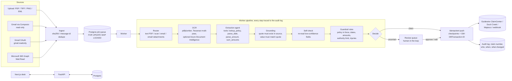

# FNOL Claims Desk — First Notice of Loss intake with AI

Reads loss notices that arrive as typed PDFs, scanned forms (PDF/TIFF/PNG) and emails, extracts the claim
fields with a tool-using LLM agent, checks them against the policy table and business rules, and either sends
the claim straight to the claims system (Guidewire ClaimCenter Cloud API, Duck Creek, Majesco or a webhook)
or puts it in front of an adjuster with the low-confidence fields highlighted.

> **Stand-in notice.** `mock_claimcenter/` is a local stand-in that follows Guidewire's published Cloud API
> request/response shapes. It is not Guidewire software. Point the Guidewire connection at a real tenant in
> Settings to go live. All sample documents, people and policies are fictional and watermarked SAMPLE.

## Architecture



## What's in the box

| Area | Where |
|---|---|
| API (FastAPI) | `backend/app/api/routes.py`, auth = bearer `APP_API_TOKEN` + role headers set by the web proxy |
| Worker + queue | `backend/app/worker.py`, `backend/app/queue.py` (retries with backoff; bad-input errors are not retried) |
| Router, OCR | `backend/app/pipeline/router.py`, `ocr.py` |
| Agent, grounding, self-check | `backend/app/pipeline/agent.py`, provider loop in `llm.py` (Anthropic default; OpenAI, Azure OpenAI) |
| Rules / guardrails | `backend/app/pipeline/validate.py`, decision in `orchestrator.py` |
| PII masking | `backend/app/security.py` (auditor role sees masked names, phones, emails, policy numbers; no scans) |
| Claims systems | `backend/app/integrations/` — Guidewire Cloud API (draft → contact → reporter → submit), Duck Creek, Majesco, webhook (HMAC-signed, Idempotency-Key) |
| Email intake | `backend/app/email_connectors/connectors.py` — read-only by construction (allow-listed Composio tools, `gmail.readonly`, Graph `Mail.Read`) |
| Credentials | Fernet-encrypted at rest, never returned by the API, each connection has **Test connection**; activation requires a passing test |
| Evals | `backend/app/evals/runner.py`, labelled set in `samples/eval/`, UI at **Evals** |
| UI | `web/` (Next.js 15, TypeScript): Dashboard, Intake (drag-drop), Review queue, claim workspace (scan left, fields right), Audit log, Settings, Evals |

### Guidewire mapping (verified against docs.guidewire.com, Cloud API Consumer Guide)

1. `POST /claim/v1/claims` — draft claim: `policyNumber`, `lossDate`, `lossCause {code}`, `description`, `lossLocation`
2. `POST /claim/v1/claims/{id}/contacts` — reporter (Person) and other parties
3. `PATCH /claim/v1/claims/{id}` — `reporter {id}`
4. `POST /claim/v1/claims/{id}/submit` — returns the claim number, stored in the audit log

Every request carries `GW-DBTransaction-ID = {push_key}-{step}`, so a retried push cannot create a second claim.
OAuth uses Guidewire Hub client credentials with scope `tenant.<tenantId>`. **Test connection** also checks that
every mapped loss-cause code exists in the tenant's `LossCause` typelist. Only `vehcollision` is confirmed from the
docs; confirm the rest of `DEFAULT_LOSS_CAUSE_MAP` against the client's typelist. Duck Creek and Majesco
use a generic REST adapter whose field mapping must be confirmed with the client's API spec.

## Run locally

Requirements: Python 3.12+, Node 22, Tesseract (`apt install tesseract-ocr poppler-utils`), Postgres 15+ (optional).

```bash
cp .env.example .env            # fill APP_API_TOKEN, FNOL_SECRETS_KEY, ANTHROPIC_API_KEY
python -m venv .venv && . .venv/bin/activate
pip install -r backend/requirements.txt
set -a; . ./.env; set +a

cd backend
alembic upgrade head            # Postgres; with SQLite (no DATABASE_URL) tables are created automatically
uvicorn app.main:app --port 8000 &
python -m app.worker &
uvicorn claimcenter_mock:app --app-dir ../mock_claimcenter --port 8090 &   # stand-in, demo only

cd ../web && npm ci && npm run build && API_URL=http://localhost:8000 npm start   # http://localhost:3000
```

Or everything at once: `docker compose up --build` (api, worker, web, postgres, mock-claimcenter).

Regenerate the sample documents: `python samples/generate.py`.

## Tests, linting, evals

```bash
cd backend && pytest -q && ruff check app tests && mypy app
cd web && npm test && npm run typecheck && npm run build
cd backend && python -m app.evals.runner --model claude-haiku-5-5        # or --provider openai --model gpt-5.4-mini
python scripts/screenshots.py                                            # Playwright screenshots of every page
```

The eval set is 14 labelled SAMPLE notices: typed and scanned forms (PDF, bitonal TIFF, PNG), free-text emails,
an email with a TIFF attachment, and deliberately bad cases (expired policy, unknown policy, amount mismatch,
high value, injury, ambiguous date, not-a-claim). It scores 11 fields per claim, the document type, the
auto-send vs review decision, and lists **unsafe auto-sends** (claims sent that should have gone to a person).

## Environment variables

See `.env.example`. Key ones: `DATABASE_URL`, `APP_API_TOKEN`, `FNOL_SECRETS_KEY`, `LLM_PROVIDER`, `LLM_MODEL`,
`ANTHROPIC_API_KEY` / `OPENAI_API_KEY` / `AZURE_OPENAI_*`, `OCR_ENGINE`, `AZURE_DI_*`, `COMPOSIO_API_KEY`,
`EMAIL_POLL_SECONDS`. Thresholds and rules (confidence threshold, authority limit, date order, fields that must be
confident, injury review) are editable at runtime in **Settings → AI & rules** and every change is audited.

## Deploy

Docker images: `backend/Dockerfile` (api and worker), `web/Dockerfile`, `mock_claimcenter/Dockerfile`.
Railway steps: [`deploy/RAILWAY.md`](deploy/RAILWAY.md).

## Security notes

- Email connectors can only read: no send, delete, label or modify call exists in the code.
- Claims-system and email secrets are encrypted with Fernet and never sent back to the browser.
- The browser never sees `APP_API_TOKEN`; the Next.js server proxy adds it.
- Roles (adjuster, supervisor, auditor) are a demo switch. Put the app behind the client's SSO before real use.
